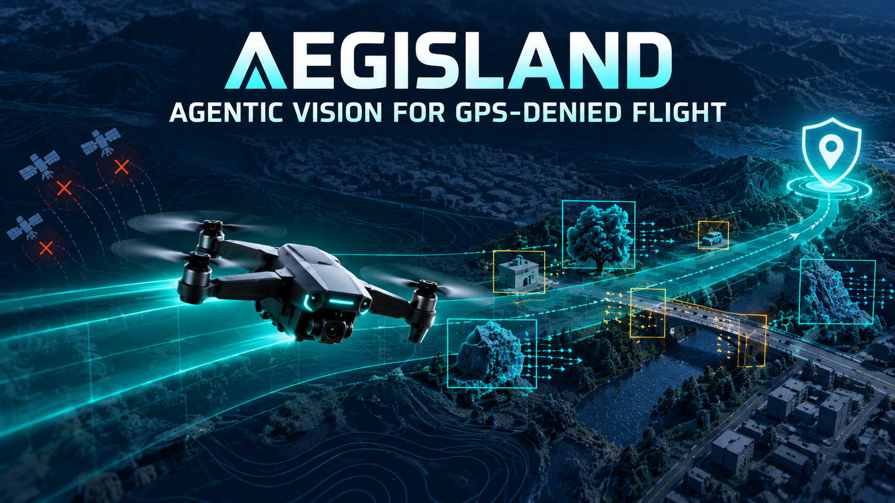
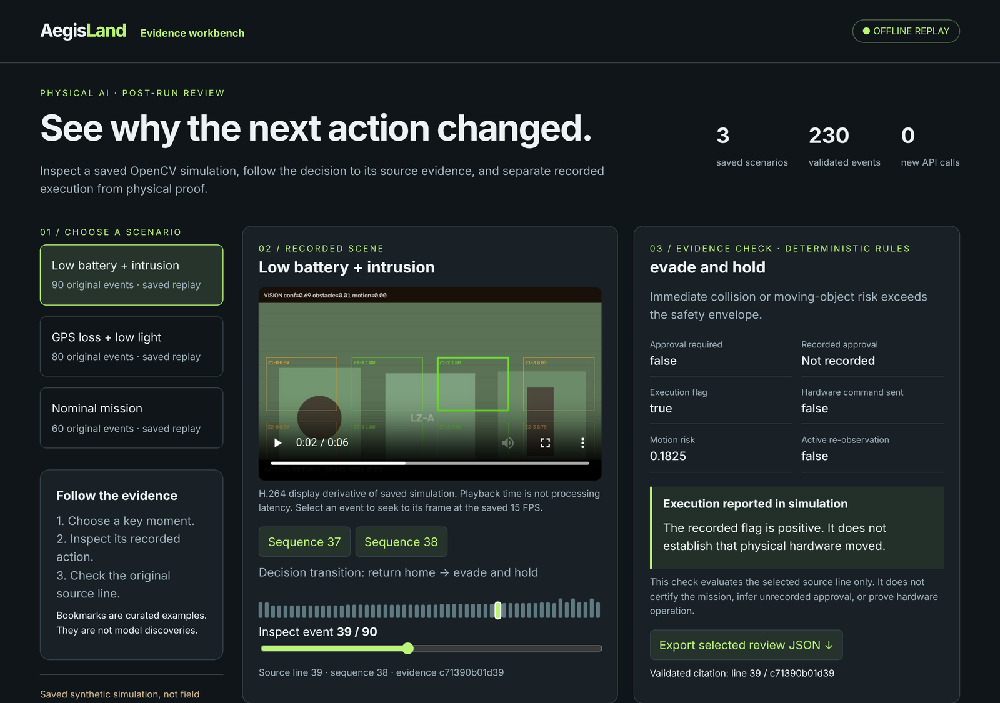
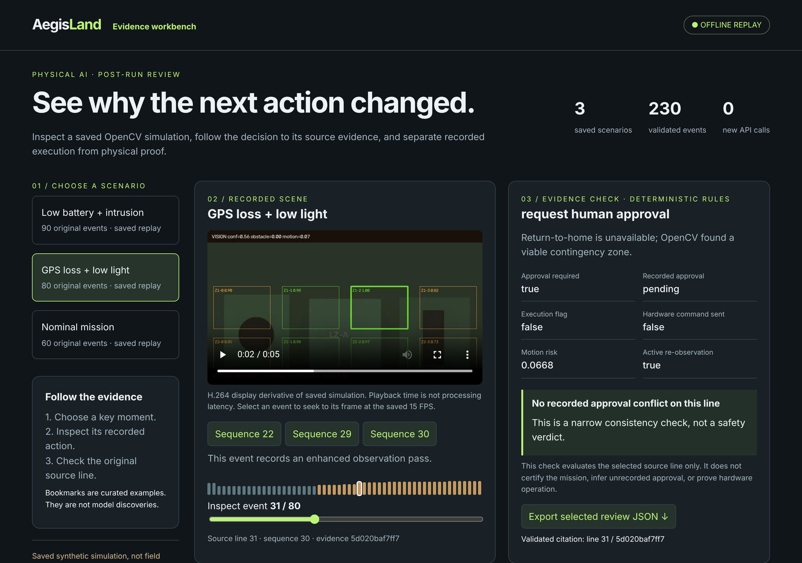
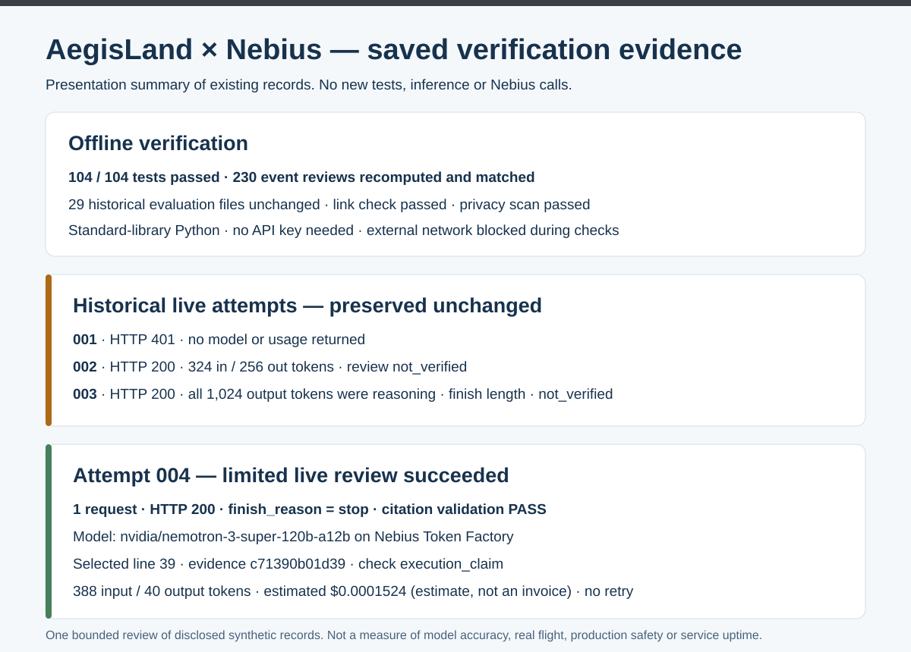

<div align="center">

# AegisLand

### See why a simulated drone changed its next action — and prove it from the source line.

**Nebius × NVIDIA Global AI Hackathon 2026 · Physical AI**

<p>
  <a href="https://github.com/Cyberchopin/aegisland-nebius-2026/actions/workflows/tests.yml"></a>
  
  
  
  <a href="#verified-results"></a>
  <a href="verification/attempt004_public_summary.json"></a>
  
</p>

**[Demo](#demo)** · **[How Nemotron is used](#how-nebius-and-nemotron-are-used)** · **[Architecture](#architecture)** · **[Verified results](#verified-results)** · **[Run locally](#run-locally)** · **[Submission guide](#submission-guide)**



<sub>Owner-provided AI concept artwork. The demonstrated system below reviews saved synthetic simulation; this illustration is not flight footage or evaluation evidence.</sub>

</div>

---

When an autonomous drone suddenly abandons its route, the operator's first question is **why**. AegisLand turns saved Physical AI simulation evidence into a **source-linked review workflow**: you move from the replay video to the exact trace line, its approval state and its execution claim in one click.

**NVIDIA Nemotron on Nebius Token Factory** picks *which* evidence record to review and *which* allowed check to run. **Local code decides everything else** — it rejects malformed or uncited output, evaluates the recorded fact itself, and never issues a flight command.

> **Demonstration scope:** saved deterministic simulation from the existing AegisLand OpenCV project, reviewed through a **new** evidence workbench and Nemotron review path. The workbench runs fully offline. **Attempt 004** is one recorded, bounded live review — not a hosted service. No aircraft hardware is involved.

| 🎯 Select | 🧪 Validate | 🧾 Preserve |
| --- | --- | --- |
| Nemotron chooses one cited event and one allowed check from a small, bounded evidence window | Strict JSON parsing; the citation must match a real line and evidence ID; a deterministic rule judges the recorded fact | Original traces and videos are hashed and never rewritten; every live attempt, including the failures, stays on record |

## Demo

Pick a scenario, jump to a key moment, and the video seeks to that frame while the evidence panel shows the original record behind the decision.



*Bundled offline workbench, captured at **source line 39 / sequence 38** — the same record Nemotron cited in Attempt 004. The verdict on the right is the deterministic check, not model output.*

| Scenario | Saved events | What to inspect |
| --- | ---: | --- |
| **Low battery + intrusion** | 90 | Intent changes from `return home` to `evade and hold` at sequence 38; execution flag is recorded, hardware command is not |
| **GPS loss + low light** | 80 | Human approval required and still pending; an enhanced re-observation pass at sequence 30 |
| **Nominal mission** | 60 | Baseline decision timeline for comparison |

<details>
<summary><strong>📸 GPS loss + low light: pending approval and active re-observation</strong></summary>



*Return-to-home is unavailable and OpenCV found a viable contingency zone, so the planner requests human approval. The check confirms there is no recorded approval conflict on this line — a narrow consistency check, not a safety verdict.*

</details>

## How Nebius and Nemotron are used

1. **Bound the evidence.** An explicit JSONL trace is validated and hashed. A small projection keeps only line and event identities, risk values, approval metadata and reported execution flags.
2. **Let the model choose, not decide.** `nvidia/nemotron-3-super-120b-a12b`, served by **Nebius Token Factory**, must return exactly one cited event and one allowed check: `approval_gate` or `execution_claim`.
3. **Verify locally.** Strict parsing rejects anything malformed. The citation must match a real line and evidence ID. A deterministic rule then evaluates the recorded fact — it never infers physical execution from a status flag or authorizes a flight action.
4. **Fall back safely.** A no-model baseline (approval conflicts first, then execution reports) shares the same parser and citation validator, so the workbench stays useful with no API key at all.

**The model never sees a command channel.** Its only power is to point at evidence.

## Architecture


**Review loop:** saved trace → bounded evidence window → Nemotron selection → strict JSON + citation validation → deterministic check on the recorded fact → workbench and exportable review JSON.

**Separate baseline:** the same records can be reviewed with no model at all. The workbench's 230 event reviews are deterministic and recomputed from original source lines.

## Verified results

| Evidence | Recorded result | Inspect |
| --- | --- | --- |
| Live review (Attempt 004) | **1 request · HTTP 200 · `finish_reason=stop` · line 39 citation PASS** | [Public summary](verification/attempt004_public_summary.json) |
| Model and usage | `nvidia/nemotron-3-super-120b-a12b` · **388 input / 40 output tokens** · est. **$0.0001524** | [Public summary](verification/attempt004_public_summary.json) |
| Offline tests | **104 / 104 passed** | [Release acceptance](verification/RELEASE_ACCEPTANCE.json) |
| Workbench reviews | **230 / 230** event reviews recomputed from original source lines | [Workbench notes](docs/REVIEW_WORKBENCH.md) |
| Historical evidence | **29 / 29** evaluation files unchanged | [Preservation record](verification/preservation.json) |
| Synthetic harness | No-model baseline **6/6** · first-event mock **1/6** | [Offline evaluation](verification/offline_evaluation.json) |

Counts are **saved results**; opening this README does not rerun them. The cost is an estimate at recorded rates, not an invoice or spending cap. Hosted support for the requested non-thinking setting remains unconfirmed.

<details>
<summary><strong>🧾 Every live attempt stays in the record</strong></summary>



| Attempt | Result | Limit |
| --- | --- | --- |
| 001 | HTTP 401; no returned model/usage | Authentication failed; precise cause unproven |
| 002 | HTTP 200, Nemotron 3 Super; 324 input / 256 output tokens; 2,304.33 ms | Review `not_verified`; old metadata cannot establish the exact failure |
| 003 | HTTP 200, same model; 324 input / 1,024 output tokens; 6,450.761 ms | All 1,024 output tokens were reasoning; finish `length`; review `not_verified` |
| **004** | **HTTP 200; exact model; `stop`; line 39 citation passed; 388 / 40 tokens** | One bounded live review; no accuracy, real-flight, production-safety or long-term-service claim |

Attempts 001–003 are unchanged. Attempt 004 made exactly one request, with no retry and no parameter downgrade. See the [B3 failure analysis](docs/B3_FAILURE_ANALYSIS.md) and [B4 reasoning remediation](docs/B4_REASONING_REMEDIATION.md).

</details>

## Run locally

### 1. Open the workbench

Python 3.11+, standard library only. No installation, API key or paid service. From the repository root:

```sh
python -B scripts/serve_review_workbench.py --directory demo --port 8090
```

Open **http://127.0.0.1:8090/**. On Windows, double-click `Start_Demo.cmd`. Videos and traces are bundled in `demo/`. This loopback address is a local preview, not a public judge endpoint.

### 2. Run the checks

```sh
python -B -m run_local_checks --output-dir runs/my-check-01
python -B scripts/check_workbench.py --directory demo
python3 -B -m unittest discover -s tests -v
```

Choose a fresh results folder each run. The check runner permits exact `127.0.0.1` connections for the video test and blocks external connections.

<details>
<summary><strong>Review a trace from the command line</strong></summary>

```sh
python3 -B -m trace_reader evaluation/traces/approval_conflict.jsonl
python3 -B -m nebius_review evaluation/traces/approval_conflict.jsonl
python3 -B scripts/demo_runbook.py --output-dir /tmp/aegisland-recording-01
python3 -B -m model_evaluation --output /tmp/nebius-offline-evaluation.json
```

The review command defaults to **SYNTHETIC / OFFLINE MOCK**, not NVIDIA inference. The runbook blocks network and live provider calls, refuses existing output folders, writes JSON plus `demo_report.html` outside the repository, and checks historical evidence hashes before and after execution. Add `--interactive` to pause between modules while recording.

Judges do not need to, and should not, re-run the live API. Do not rerun historical smoke commands or reset consumed guards.

</details>

## Submission guide

| Start here | Purpose |
| --- | --- |
| [Devpost copy](submission/DEVPOST_COPY_EN.md) | English project description |
| [Video plan](submission/VIDEO_PLAN_EN.md) | Under-three-minute recording plan |
| [Release status](RELEASE_STATUS.md) | Current verified state and remaining owner actions |
| [Evidence summary](docs/submission/EVIDENCE_SUMMARY.md) | Evidence table and artifact hashes |
| [Workbench notes](docs/REVIEW_WORKBENCH.md) | Reuse, build instructions and next milestones |
| [Contracts](docs/TRACE_READER_CONTRACT.md) | Trace reader contract; see also the [evaluation contract](docs/MODEL_EVALUATION.md) and [live API gate](docs/LIVE_API_GATE.md) |

<details>
<summary><strong>Scope, provenance and license</strong></summary>

- **Prior work.** The [AegisLand core](https://github.com/Cyberchopin/aegisland-agentic-vision) (baseline `eda23d3`) and its [OpenCV submission](https://github.com/Cyberchopin/aegisland-opencv-2026) produced the three simulation replays and 230 trace events. They are disclosed prior work. No core module or model weight is imported or copied; `demo/` bundles the owner's saved traces and display-video derivatives with their upstream identities.
- **New during this hackathon.** The Nebius Token Factory + NVIDIA Nemotron review path, bounded evidence windows, strict JSON and citation validation, approval and execution consistency checks, the source-linked workbench, public-safe provenance, and the deterministic fallback with retained failures.
- **Not claimed.** All traces are synthetic simulation. Hardware operation, flight certification, safety improvement, model accuracy, model speedup and long-term service availability are not established. There is no always-on public API endpoint, and the API key has been deleted.
- **License.** This integration is [MIT licensed](LICENSE). The license does not cover external model, core or service rights, or grant a new license over the imported records and media. See [third-party boundaries](THIRD_PARTY_NOTICES.md), [demo asset rights](demo/ASSET_RIGHTS.md) and [README visual provenance](docs/assets/readme/ASSETS.md).

</details>
